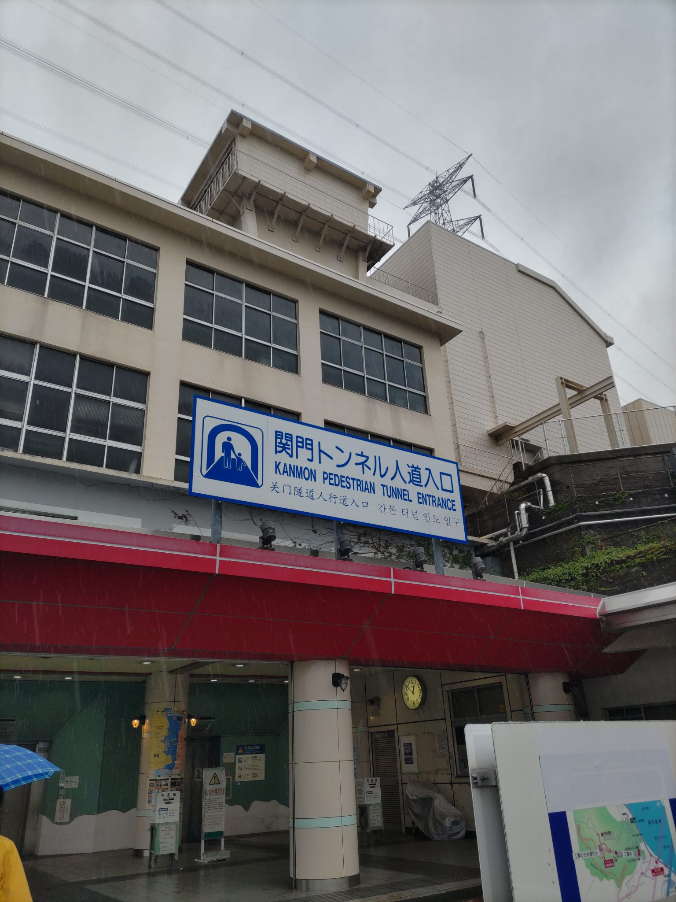
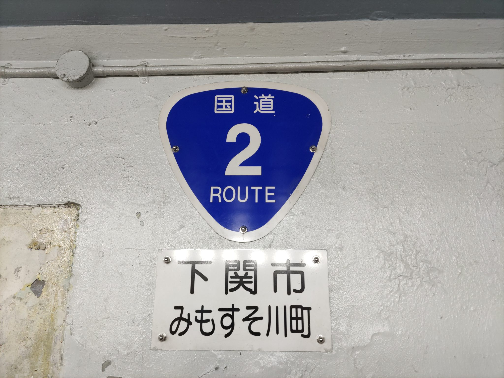
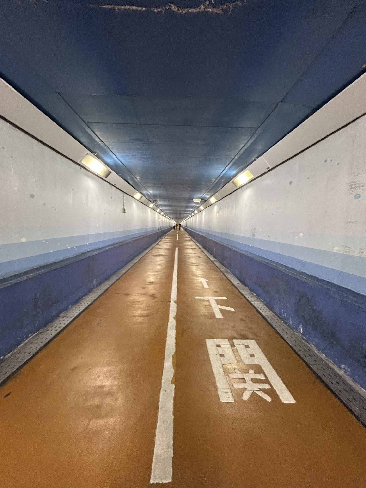
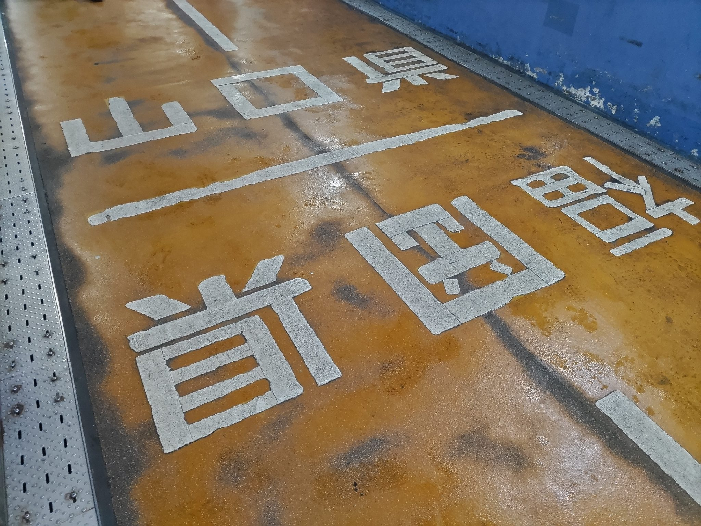

「歩いて九州に行ってきた」

というと、「いやいや、無理でしょ」「何日かかったんですか（笑）」といったリアクションが予想されます。

が、本当に歩いて九州に行けます。

それは関門海峡の真下にある「関門トンネル人道」を通るルートです。

まずは本州側の関門橋の真下にある「関門トンネル人道入口（下関側）」を目指します。

目の前の海峡を眺めると「これからここを越えて向こう岸に行くんだ」とワクワクしてきます。

人道入口の建物に入り、エレベーターで一気に地下約55メートルまで降ります。扉が開くと、まるで「8番出口」のような、何とも言えない独特の雰囲気。

全長約780メートルの「関門トンネル人道」は、国道2号線の一部でありながら、歩行者・自転車・原付（※押し歩き必須）専用の海底トンネルです。通行料は、歩行者は無料です。

まさにいま、海の下を歩いている！

門司側まで、徒歩でおよそ15分。

8分ほど歩くと、「山口県（下関市） / 福岡県（北九州市）」の県境ラインです。

ここが、海の下の県境！

もちろん、県境に立って、片足を山口県、もう片足を福岡県に跨って写真撮影しましたよ。

徒歩で県境を跨ぐという、確かな実感が胸に込み上げます。

今回は、時間がなくて、門司側の地上には出ませんでしたが、下関側から歩いて門司港に行き、名物の焼きカレーを食べて、また徒歩で戻ってくる、という芸当もできるわけです。いずれチャレンジしようと思っています。

- 所要時間：人道トンネル自体は徒歩約15分〜20分程度
- 通行料：歩行者は無料（自転車・原付は20円）
- その他：下関側と門司側の両方で記念スタンプを押すと貰える「関門突破証明書」も旅のいい記念になります。

「歩いて九州へ行く」というちょっと特別な体験。日常の延長線上にあるささやかな冒険として、おすすめしたいルートです。
